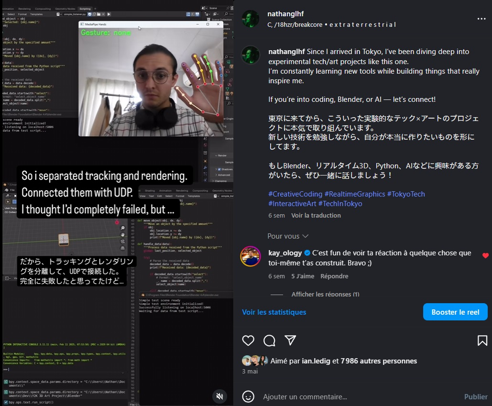

# RTHT-3D : Real-Time Hand Tracking 3D Art Project

[](LICENSE)
[](CONTRIBUTING.md)

An interactive 3D art framework combining hand gesture recognition with a nostalgic Y2K aesthetic. This project enables users to manipulate 3D objects in a Blender environment using intuitive hand gestures captured through a webcam, inspired by futuristic interfaces from films like Minority Report.


## Public demo

A short demonstration of the hand-tracking interface reached exactly **343,000
views on Instagram**, showing how a technical prototype can also engage people
outside the development community. View count recorded in August 2026.

<div align="center">
  <a href="https://www.instagram.com/reel/DJLriUMSSpy/">
    
  </a>
</div>

[Watch the demonstration on Instagram](https://www.instagram.com/reel/DJLriUMSSpy/).

## ✨ Features

- Real-time hand tracking and gesture recognition using MediaPipe
- Interactive 3D environment with Y2K-inspired visuals
- Two-hand gesture support for advanced interactions
- Intuitive gestures: point to select, pinch to move, and more
- RGB color plane separation effects
- Sound feedback for interactions
- Client-server architecture connecting Python (vision) and Blender (3D)

## 🚀 Quick Start

### Prerequisites

- Python 3.7+
- Blender 2.93+ (3.x recommended)
- Webcam with clear view of your hands

### Installation

1. Clone the repository:
   ```bash
   git clone https://github.com/NathanKneT/RTHT-3D
   cd RTHT-3D
   ```

2. Install required Python dependencies:
   ```bash
   pip install -r requirements.txt
   ```

3. Create necessary directories:
   ```bash
   mkdir -p sounds images
   ```

### Running the Project

1. Start the Blender environment:
   ```bash
   blender sandbox.blend
   ```

2. In Blender, open the Scripting tab and run `blender_listener.py`

3. In a separate terminal, run the hand tracking module:
   ```bash
   python hand_tracking.py
   ```

4. Position your hands in view of the webcam and start interacting!

## 🖐️ Gesture Guide

| Gesture | Hands | Action |
|---------|-------|--------|
| Point (index finger) | One | Select object |
| Pinch (thumb + index) | One | Move selected object |
| Pinch | Two | Rotate and scale object |
| V Sign | Two | Duplicate selected object |
| Palm | Two | Create new object |
| Fist | Two | Delete selected object |
| Palm + Pinch | Two | Toggle RGB separation effect |

## 🧩 Project Structure

```
project/
├── hand_tracking.py        # Hand tracking and gesture recognition module
├── Blender/
│   ├── sounds/                 # Sound effect files (not provided)
│   ├── images/                 # Custom images for texture mapping (not provided)
│   ├── blender_listener.py     # Blender script for 3D environment and UDP listener
│   ├── sandbox.blend           # Blender sandbox scene for testing
├── requirements.txt        # Python dependencies
├── docs/                   # Documentation resources
└── examples/               # Example configurations and outputs
```

## 🛠️ Customization

### Adding Custom Images

Place your images in the `images/` directory to have them automatically loaded as textures for the 3D planes in Blender.

### Adjusting Materials Aesthetics

Modify the `create_y2k_material()` function in `blender_listener.py` to customize:
- Colors and glow intensity
- Transparency effects
- Material properties

### Network Configuration

By default, the system uses `localhost:5006` for communication. To change:
1. Update `blender_address` in `hand_tracking.py`
2. Update `HOST` and `PORT` in `blender_listener.py`

## 🤝 Contributing

Contributions are welcome! See [CONTRIBUTING.md](CONTRIBUTING.md) for detailed guidelines.

### Development Setup

1. Fork the repository
2. Create a feature branch: `git checkout -b feature/amazing-feature`
3. Make your changes
4. Run the linter: `flake8 *.py`
5. Commit your changes: `git commit -m 'Add amazing feature'`
6. Push to the branch: `git push origin feature/amazing-feature`
7. Open a Pull Request

### Code Style

This project follows PEP 8 guidelines. Please ensure your code is properly formatted using:
```bash
black .
```

## 🔍 Troubleshooting

### Common Issues

- **Socket Error**: Ensure no other application is using port 5006
- **No Hand Detection**: Check lighting conditions and camera position
- **Blender Not Responding**: Verify the Blender script is running properly
- **Missing Libraries**: Run `pip install -r requirements.txt` again

For more detailed troubleshooting, see the [Troubleshooting Guide](docs/troubleshooting.md).

## 🗺️ Roadmap

- [ ] Additional gesture support
- [ ] VR/AR integration
- [ ] Animation recording and playback
- [ ] Custom shader effects library

## 📜 License

This project is licensed under the MIT License - see the [LICENSE](LICENSE) file for details.

## 🙏 Acknowledgments

- MediaPipe team for the hand tracking technology
- Blender Foundation for the 3D creation platform
- All contributors who have helped shape this project

## 📬 Contact

Project Link: [https://github.com/NathanKneT/RTHT-3D](https://github.com/NathanKneT/RTHT-3D)

Join our [Discord GLHF community](https://discord.gg/akNR2Yc97T) for discussions and support!
